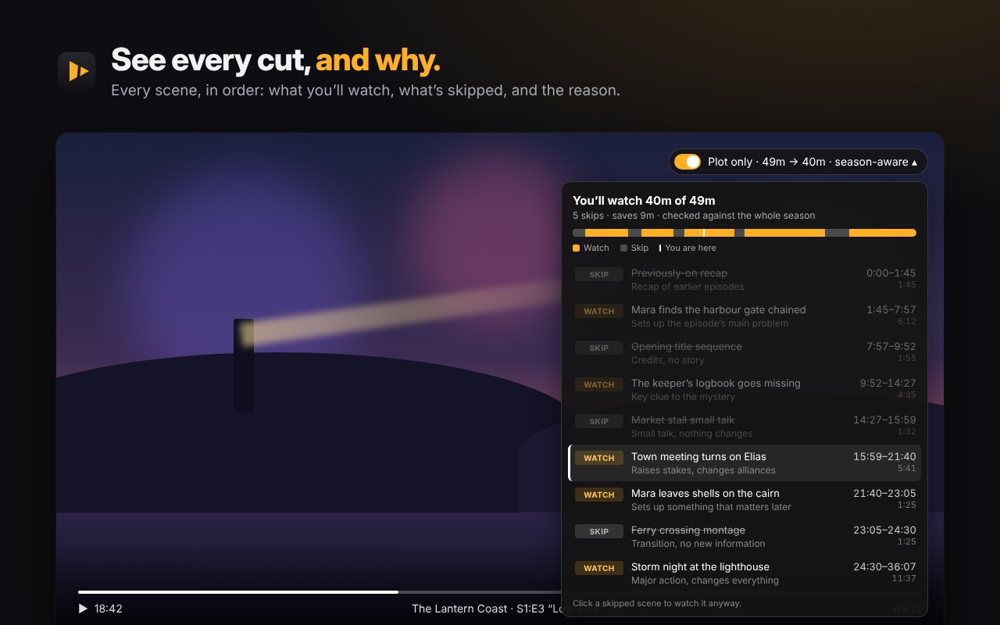

# Plot Only — skip the filler

**An agent that watches Netflix with you and skips everything that isn't story** — recaps, title sequences, small talk, side plots. For series it reads the whole season first, so moments that set up later episodes are kept.

On the shows tested: watch **4 episodes in the time of 3** (about 25% shorter on average, up to 40% on some episodes).

<p align="center"></p>

## How to use it

1. Install **Plot Only** from the Chrome Web Store (no account needed).
2. Play anything on Netflix in desktop Chrome (or Edge, Brave and other Chromium browsers).
3. A **Plot only** badge appears at the top right of the player. The first viewer of a title waits about a minute while it is analyzed; after that it's instant for everyone.
4. Filler is skipped automatically. Click the badge to see every scene, what's kept, what's skipped and why. Click any skipped scene to watch it anyway.

## How it works

- Netflix video is DRM-protected, so the extension never touches it. It reads the **subtitles** and the **scrub-bar preview thumbnails** (one frame every ~10s) from Netflix's own player.
- The server sends dialogue plus contact sheets of frames to **Claude**, which splits the title into scenes and decides keep/skip, with a short, spoiler-free reason for each.
- **Season look-ahead:** for series, the extension asks Netflix's player to prefetch only the other episodes' manifests (subtitle links — no video, no DRM licenses). The server builds a season story map (per-episode beat sheets → setups that pay off later) and re-plans the episode with those notes.
- Every plan is **cached per title** on the server, so each episode is analyzed once and is free and instant for everyone after.

## Repository layout

| Folder | What it is |
|---|---|
| `extension/` | Chrome extension (Manifest V3). `inject.js` runs in Netflix's page (captures subtitle/thumbnail links, skips scenes, draws the UI); `bridge.js` relays to `background.js` (downloads subtitles/frames, talks to the server, caches plans); `popup.*` is the toolbar popup. |
| `server/` | Cloudflare Worker that holds the Anthropic API key, calls Claude, caches plans and season maps in KV, and rate-limits new analyses. |
| `store-assets/` | Chrome Web Store icon, screenshots and promo images. |

## Run it yourself

**Extension (development):** open `chrome://extensions`, enable Developer mode, click **Load unpacked** and select `extension/`.

**Server:**

```bash
cd server
./setup.sh   # installs wrangler, signs in to Cloudflare, creates the KV store, deploys, asks for your Anthropic API key
```

Then set `DEFAULT_SERVER` in `extension/background.js` (and `SERVER` in `extension/popup.js`) to your `*.workers.dev` address. Daily cost caps live in `server/wrangler.toml` (`DAILY_NEW_LIMIT`, `PER_IP_DAILY_LIMIT`).

Alternatively, open the extension popup → **Advanced** → use your own Anthropic API key, and no server is needed.

## Limits

- Desktop Chromium browsers only; Netflix only for now. TV and mobile apps can't be extended.
- Relies on Netflix's internal player and manifest format, which can change without notice.
- Visual understanding comes from one preview frame every ~10 seconds, not full video.

## Privacy

Subtitles and preview thumbnails of the title being watched are sent to the Plot Only server and to Anthropic's API to produce the scene plan. No account, no tracking, no ads. Full policy: https://plot-only-api.riteshpgiri.workers.dev/privacy

---

Plot Only is an independent project and is not affiliated with or endorsed by Netflix.
